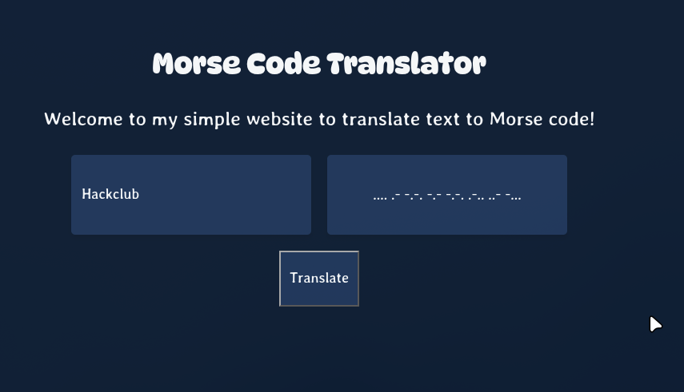

# Morse Code Translator

I made this website for fun because I was bored, it's main purpose is to serve as a simple translater between English and Morse code.

## Screenshots

### Home

This is the main and only page (for now!) of my website. It contains 1 input text bar where you type text and when you click the translate text button, it translates it into Morse code displaying it on the page.

## Viewing the Project

Want to check out my website? There are two ways to do it!

**Option 1: Open the Demo**

Just open the demo link in the right sidebar of the repository (if available) and check out my website.

**Option 2: Run It Locally**

1. Clone this repository to your computer.
2. Open the folder you downloaded.
3. Double-click `index.html`.
4. That's it! My website should open in your default web browser.

No complicated setup or installing a million different things required. Just open it and take a look!

## Tech Stack

Here's what I used to build my website:

- **HTML5:** Used to structure my website and organize the content across my home, projects, and donate pages.
- **CSS3:** Used to style my website, including the layout, colors, fonts, spacing, and overall appearance.
- **JavaScript:** I used this to add interactiveness to my website by making using this to actually translate.
- **Web Browser:** Used to run and display my website. Since I use standard web technologies, I can open it directly in a browser without needing a complicated build process.

I kept things simple by using standard web technologies, making my website easy to open, view, and work on.

## Overview and How to Use

Morse Code Translator is a personal project created by me for fun and it has 1 simple purpose: to translate between English and Morse code all via the use of simple HTML,CSS and JS.

## Contributing

It's my website and my projects, so idk why you'd wanna commit to it but if you have ideas for improvements, find a bug, or want to suggest something, feel free to do so!

If you decide to contribute, please make sure your changes are useful and include a descriptive commit message explaining what you changed. Something like `Improve projects page layout` is a lot better than `fixed stuff lol`.

## License

This project is licensed under the MIT License. Check out the [LICENSE.md](LICENSE.md) file for the full license text.